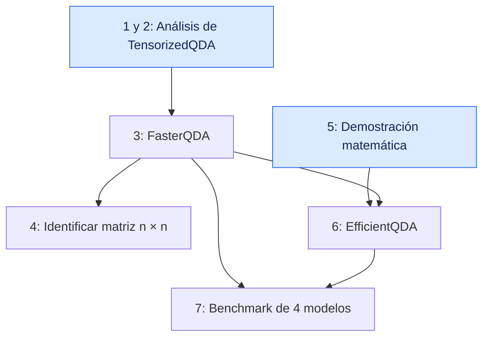
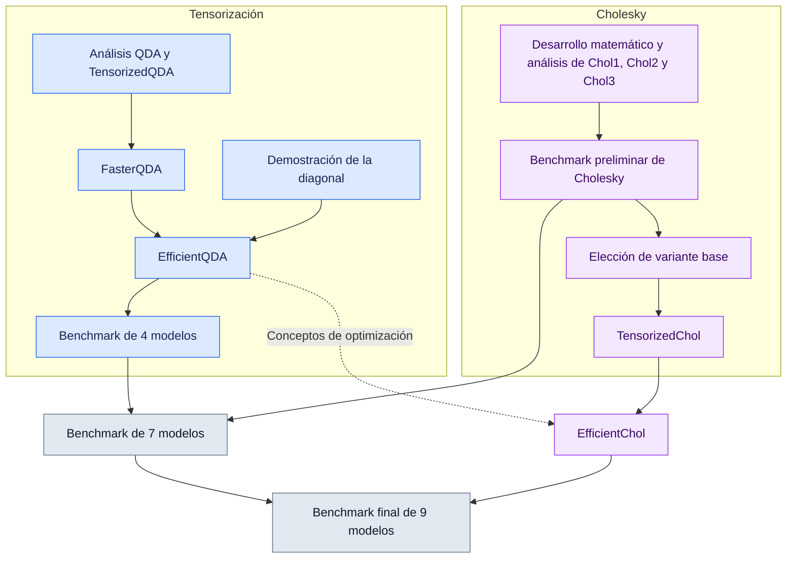

# Plan de acción — TP QDA

## 1. Objetivo y organización general

El TP se divide en dos grandes bloques: **Tensorización**, orientado a optimizar la predicción, y **Cholesky**, orientado inicialmente a optimizar el entrenamiento y luego también la predicción. Ambos pueden iniciarse en paralelo. Las principales dependencias aparecen en los benchmarks globales y en la implementación de `EfficientChol`.

> La numeración original de la consigna contiene puntos repetidos (7, 8 y 13). En este plan se conserva esa numeración y se distingue cada punto por su contenido.

## 2. Modelos y archivos disponibles

| Modelo | Estado | Archivo / bloque |
| --- | --- | --- |
| `QDA` | Implementado | `qda.py` |
| `TensorizedQDA` | Implementado | `qda.py` |
| `FasterQDA` | Pendiente | Tensorización |
| `EfficientQDA` | Pendiente | Tensorización |
| `QDA_Chol1` | Implementado | `cholesky.py` |
| `QDA_Chol2` | Implementado | `cholesky.py` |
| `QDA_Chol3` | Implementado | `cholesky.py` |
| `TensorizedChol` | Pendiente | Cholesky |
| `EfficientChol` | Pendiente | Cholesky |

Son nueve modelos en total: cinco provistos y cuatro por desarrollar. `FasterChol` es opcional y no forma parte de los nueve modelos obligatorios.

| Archivo auxiliar | Función |
| --- | --- |
| `bayesian.py` | Clase base de los clasificadores: entrenamiento, probabilidades a priori y predicción. |
| `bench.py` | Benchmark de tiempos, memoria y accuracy. |
| `datasets.py` | Carga de Iris, Penguins, Wine y Letters, codificación de etiquetas y separación train/test. |

## 3. Dependencias entre puntos

### Bloque A — Tensorización

| Punto | Actividad | Dependencia | Dificultad estimada |
| --- | --- | --- | --- |
| 1 | Explicar sobre qué dimensión paraleliza `TensorizedQDA`. | Independiente; código provisto. | Baja |
| 2 | Analizar shapes y explicar la predicción de `TensorizedQDA`. | Relacionado con 1; código provisto. | Baja |
| 3 | Implementar `FasterQDA`, eliminando el `for` de `predict`. | Comprender 1 y 2. | Media |
| 4 | Identificar dónde aparece la matriz n × n. | Implementación o diseño del punto 3. | Baja |
| 5 | Demostrar la propiedad de la diagonal. | Independiente; demostración matemática. | Baja |
| 6 | Implementar `EfficientQDA`. | Conceptos de 3 y 5. | Media |
| 7 | Comparar performance de los cuatro modelos. | `FasterQDA` y `EfficientQDA` terminados. | Media |

Los puntos 1, 2 y 5 pueden iniciarse inmediatamente. El punto 5 no requiere ninguna implementación previa. Aunque la consigna plantea `EfficientQDA` como una mejora de `FasterQDA`, no es necesario esperar a tener su código terminado si ya se comprende su formulación.

### Bloque B — Cholesky

| Punto original | Actividad | Dependencia | Dificultad estimada |
| --- | --- | --- | --- |
| 8 (primero) | Expresar la inversa de A en términos de L y relacionarla con QDA. | Independiente; desarrollo matemático. | Media |
| 7 (repetido) | Explicar diferencias entre `QDA_Chol1` y `QDA`. | Relacionado con el anterior; código provisto. | Baja-media |
| 8 (segundo) | Comparar `QDA_Chol1`, `QDA_Chol2` y `QDA_Chol3`. | Independiente de Tensorización; código provisto. | Baja |
| 9 | Benchmark de siete modelos. | Cuatro modelos de Tensorización y tres de Cholesky. | Media |
| 12 | Implementar `TensorizedChol`. | Comprender Cholesky y seleccionar una variante base mediante benchmarks. | Media |
| 13 (primero) | Implementar `EfficientChol`. | `TensorizedChol` y conceptos de `EfficientQDA`. | Media-alta |
| 13 (segundo) | Benchmark de nueve modelos. | Todos los modelos obligatorios terminados. | Media |

Se pueden comparar las tres variantes de Cholesky desde el inicio, sin esperar a Tensorización. Este benchmark preliminar permite elegir una clase base para el punto 12; no reemplaza el benchmark obligatorio de siete modelos del punto 9.

## 4. Diagrama general de dependencias

La elección de la variante base de `TensorizedChol` debe justificarse con los resultados del benchmark obligatorio, aunque su desarrollo pueda adelantarse con resultados preliminares. La dependencia de `EfficientChol` respecto de `EfficientQDA` es principalmente conceptual, no necesariamente de herencia de clases.

## 5. Propuesta de división del trabajo (dos integrantes)

| Responsabilidad | Integrante 1 | Integrante 2 |
| --- | --- | --- |
| Bloque | Tensorización | Cholesky |
| Análisis de código | `QDA`, `TensorizedQDA` | `QDA_Chol1`, `QDA_Chol2`, `QDA_Chol3` |
| Desarrollo matemático | Propiedad de la diagonal | Factorización e inversa de Cholesky |
| Implementaciones | `FasterQDA`, `EfficientQDA` | `TensorizedChol`, `EfficientChol` |
| Benchmark individual | Cuatro modelos | Tres variantes de Cholesky (preliminar) |
| Responsable asignado | A definir | A definir |

**Trabajo en conjunto:** integración del código, validación de predicciones, benchmarks de siete y nueve modelos, interpretación de resultados y conclusiones.

La carga parece relativamente equilibrada en cantidad de implementaciones, aunque `EfficientChol` puede requerir más trabajo. La dificultad es una estimación basada en la lectura del código, no en pruebas ejecutadas.

## 6. Orden de ejecución y puntos de sincronización

| Etapa | Integrante 1 | Integrante 2 | Sincronización |
| --- | --- | --- | --- |
| 0 | Configurar entorno y probar modelos existentes. | Configurar entorno y probar modelos existentes. | Acordar datasets, parámetros y pruebas. |
| 1 | Puntos 1, 2 y 5. | Primeros tres puntos teóricos de Cholesky. | No necesaria. |
| 2 | `FasterQDA`, matriz n × n y `EfficientQDA`. | Benchmark preliminar y `TensorizedChol`. | Compartir criterios de tensorización y optimización. |
| 3 | Benchmark de cuatro modelos. | `EfficientChol`. | Compartir solución conceptual de `EfficientQDA`; benchmark de siete modelos y confirmar variante base. |
| 4 | Integración y validación. | Integración y validación. | Benchmark de nueve modelos y conclusiones. |

## 7. Acuerdos técnicos antes de comenzar

- Mantener la convención del código: `X` tiene shape `(p, n)` y `y` tiene shape `(1, n)` después de `split_transpose`. Las predicciones deben tener shape `(1, n)`.
- Codificar las etiquetas como enteros consecutivos desde cero con `label_encode`.
- Respetar los nombres y la interfaz de los modelos (`fit`, `predict`). Como propuesta, agregar las nuevas clases a `qda.py` y `cholesky.py`, respectivamente.
- Revisar la estructura de carpetas: los imports existentes esperan `base.bayesian` y `utils.datasets`.
- Acordar datasets, semilla, tamaño de test, cantidad de ejecuciones y entorno de ejecución. Utilizar las mismas particiones para todos los modelos (`same_splits=True`).
- Validar las predicciones de cada modelo contra `QDA` sobre las mismas particiones; investigar discrepancias numéricas si aparecen. La accuracy por sí sola no garantiza predicciones idénticas.
- Usar pocas ejecuciones durante el desarrollo. El benchmark por defecto realiza 100 de warmup, 100 de memoria y 1000 de tiempo: 1200 por modelo. Reservar las ejecuciones completas para la comparación final, según recursos disponibles.
- Considerar que `FasterQDA` puede generar un tensor de shape `(k, n, n)`; comenzar con datasets pequeños antes de probar grandes cantidades de observaciones.
- Comparar tiempos de entrenamiento y predicción, memoria y accuracy. La memoria de `bench.py` es la registrada por `tracemalloc`, no necesariamente toda la memoria del proceso; el pico de predicción incluye memoria retenida del entrenamiento.

## 8. Checklist de seguimiento

### Preparación compartida

- [ ] Asignar responsables.
- [ ] Definir datasets y configuración de benchmarks.
- [ ] Verificar entorno, imports y ejecución de modelos provistos.
- [ ] Definir prueba de equivalencia de predicciones.

### Integrante 1 — Tensorización

- [ ] Punto 1: explicar dimensión de paralelización.
- [ ] Punto 2: analizar shapes y flujo de predicción.
- [ ] Punto 3: implementar y validar `FasterQDA`.
- [ ] Punto 4: identificar matriz n × n.
- [ ] Punto 5: demostrar propiedad de la diagonal.
- [ ] Punto 6: implementar y validar `EfficientQDA`.
- [ ] Punto 7: benchmark de cuatro modelos e interpretación.

### Integrante 2 — Cholesky

- [ ] Punto 8 (primero): desarrollo matemático.
- [ ] Punto 7 (repetido): explicar `QDA_Chol1` frente a `QDA`.
- [ ] Punto 8 (segundo): comparar las tres implementaciones.
- [ ] Benchmark preliminar de Cholesky y elección provisional de clase base.
- [ ] Punto 12: implementar y validar `TensorizedChol`.
- [ ] Punto 13 (primero): implementar y validar `EfficientChol`.

### Integración y entrega

- [ ] Punto 9: benchmark de siete modelos y justificación de la variante base elegida.
- [ ] Revisar la elección de base de `TensorizedChol` si los resultados lo requieren.
- [ ] Punto 13 (segundo): benchmark de nueve modelos.
- [ ] Interpretar resultados frente a lo esperado teóricamente.
- [ ] Revisar código, desarrollos matemáticos y documentación final.

## 9. Conclusión

No es necesario resolver el TP estrictamente en el orden de la consigna. Ambos integrantes pueden avanzar en paralelo desde el comienzo. Las principales instancias de coordinación son la transferencia de los conceptos de `EfficientQDA` a `EfficientChol`, la elección definitiva de la variante de Cholesky y las comparaciones globales de performance.
